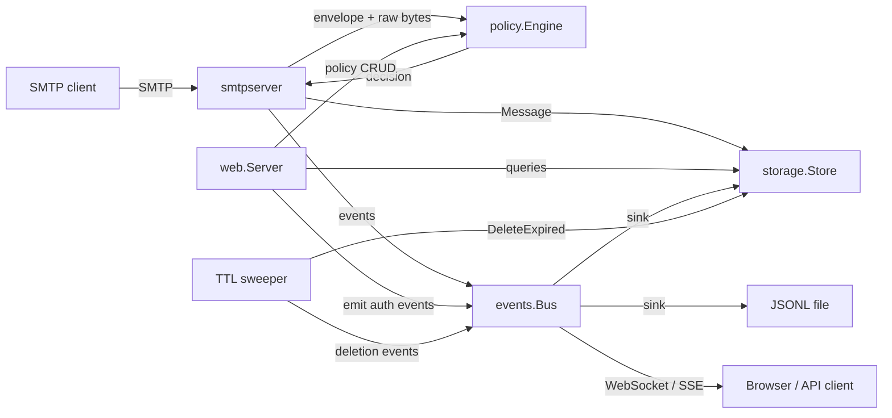
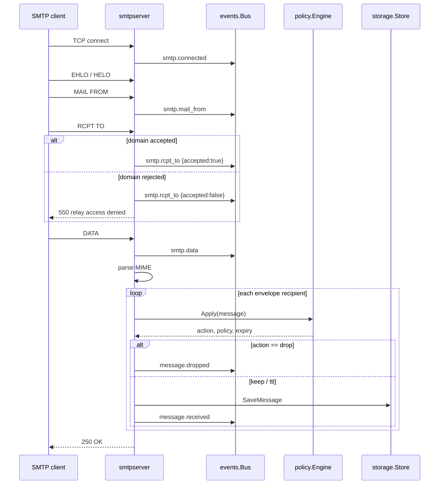

# Architecture

MailVoid is a single process with four internal planes:

1. **Capture plane** — SMTP listeners in `internal/smtpserver`.
2. **Decision plane** — the regex engine in `internal/policy`.
3. **Memory plane** — the event bus in `internal/events` and repositories in
   `internal/storage`.
4. **Presentation plane** — the Fiber server in `internal/web`.

## Component diagram



## Mail flow



A rejected recipient never reaches `DATA`, so nothing is stored. A policy
rejection (drop) happens after `DATA` and still returns success to the client:
the message is accepted and silently discarded, which is the expected behavior
for a blackhole.

## Event flow

```mermaid
flowchart TD
    E[Emit(Event)] --> N[Normalize ID / timestamp / severity]
    N --> R[Append to 256-event ring]
    N --> S1[Write JSONL sink]
    N --> S2[Insert into Genji events table]
    N --> B[Broadcast to live subscribers]
    B --> WS[WebSocket clients]
    B --> SSE[Server-Sent Events clients]
```

Sinks are called synchronously so an event that caused a state change is
persisted before the emitter continues. Live subscribers are non-blocking: a
slow client loses events rather than delaying SMTP or the HTTP server. The
durable JSONL and database records are the authoritative history.

## Package layout

| Package | Responsibility |
|---------|----------------|
| `cmd/mailvoid` | Composition root: config, storage, sinks, SMTP, web, sweeper, signals |
| `internal/auth` | bcrypt hashing, credential verification, bootstrap admin |
| `internal/build` | Link-time version metadata |
| `internal/config` | Defaults, environment, flags, validation, domain matching |
| `internal/events` | Event model, bus, JSONL sink |
| `internal/mailbox` | Mailbox aggregation, message pages, delivery waits |
| `internal/mailparse` | MIME body and header extraction |
| `internal/models` | Domain types and identifiers |
| `internal/policy` | Ordered regex evaluation, validation, TTL decisions |
| `internal/search` | Bleve index, indexing decorator, query/filter mapping |
| `internal/smtpserver` | Multi-port listeners and SMTP session handling |
| `internal/storage` | `Store` interface, in-memory and Genji repositories |
| `internal/web` | Fiber routes, auth middleware, API, MCP, WebDAV, search, SSR, assets |
| `cmd/mailvoid-it` | Standalone TUI/batch integration client |

Dependency direction is acyclic:

```text
models ← events ← storage ← policy ← smtpserver ← web ← cmd/mailvoid
```

`events` knows nothing about storage. `storage` imports `events` only to
implement the `events.Sink` interface (`Write(Event) error`). The web layer does
not import the SMTP server. The composition root wires everything together.

## Agent and file surfaces

`/api/v1` and `/mcp` share the same store and mailbox service. Both accept the
configured bearer token or a session cookie. `/dav/` is a separate read-only
WebDAV filesystem with its own Basic-auth credentials; it exposes mailbox
directories and raw `.eml` files. None of these surfaces can write messages,
although the API and MCP can delete them.

## Single-binary assets

`internal/web` embeds two trees with `go:embed`:

- `templates/` — layouts, pages, partials, and HTMX fragments.
- `static/` — pinned DaisyUI/Tailwind CSS, HTMX, Cash, and local CSS/JS.

No files are read from disk at runtime for the UI. The database path and event
log path are the only writable state.

## Concurrency model

| Area | Model |
|------|-------|
| SMTP | One goroutine per connection, managed by go-smtp |
| Genji writes | Serialized by a mutex |
| Genji reads | Concurrent under an RWMutex |
| Event bus | Copy-on-emit subscriber list, non-blocking sends |
| In-memory store | RWMutex with cloned message values |
| TTL sweeper | One background goroutine; interval configurable |
| Sessions | Fiber in-memory session store |
| HTTP | Fiber/fasthttp event loop |

## Failure behavior

| Failure | Behavior |
|---------|----------|
| Malformed MIME | Raw message stored, subject `(unparsable message)`, `smtp.error` emitted |
| Policy storage error | Message kept, `smtp.error` emitted |
| Policy engine error | Message kept, `smtp.error` emitted |
| Database write failure | SMTP returns `451` so the client can retry |
| Message exceeds size limit | SMTP returns `552` |
| Recipient domain rejected | SMTP returns `550` and emits `smtp.rcpt_to` with `accepted:false` |
| Event sink failure | Logged nowhere by the bus; the mutation still completes. JSONL and DB sinks are best-effort on a per-event basis |

> [!NOTE]
> Event sink errors are intentionally ignored to prevent an audit failure from
> blocking mail capture. Monitor the data directory and disk space if audit
> durability is critical.

## Why Genji?

Genji provides an embedded, Go-native document database with no external service
or CGO requirement. The repository seam keeps the dependency isolated: if Genji
is replaced (upstream renamed to Chai and newer versions require a newer Go
toolchain), only `internal/storage/genji.go` changes. See
[Storage](/reference/storage/) for the pinned version and tradeoffs.
