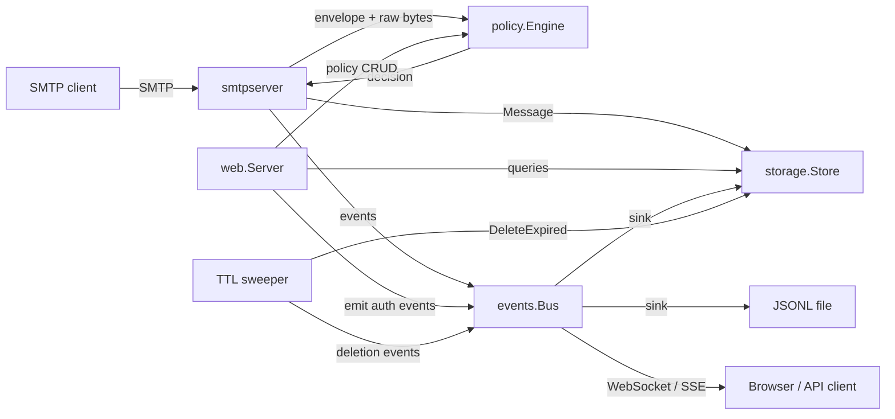
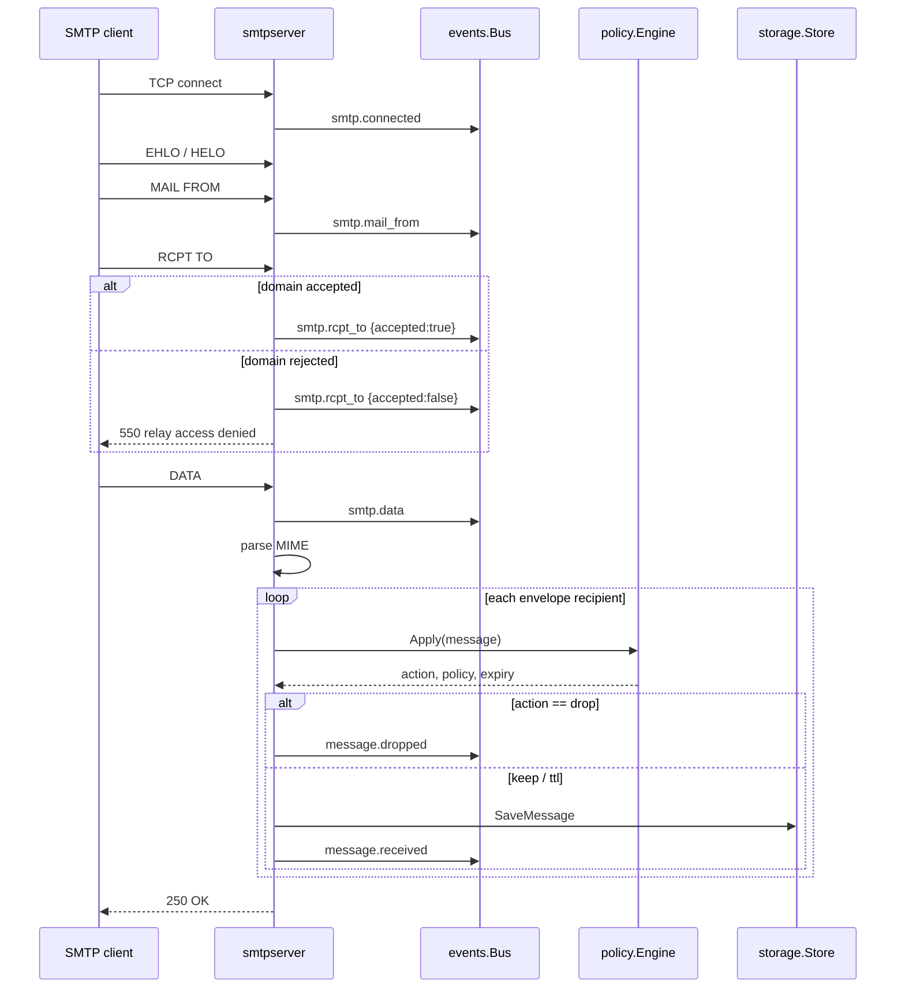

# Arquitectura

MailVoid es un único proceso con cuatro planos internos:

1. **Plano de captura** — listeners SMTP en `internal/smtpserver`.
2. **Plano de decisión** — el motor regex en `internal/policy`.
3. **Plano de memoria** — el bus de eventos en `internal/events` y los
   repositorios en `internal/storage`.
4. **Plano de presentación** — el servidor Fiber en `internal/web`.

## Diagrama de componentes



## Flujo del correo



Un destinatario rechazado nunca llega a `DATA`, por lo que no se almacena nada.
Un rechazo por política (drop) ocurre después de `DATA` y aun así devuelve éxito
al cliente: el mensaje se acepta y se descarta en silencio, que es el
comportamiento esperado para un agujero negro.

## Flujo de eventos

```mermaid
flowchart TD
    E[Emit(Event)] --> N[Normalize ID / timestamp / severity]
    N --> R[Append to 256-event ring]
    N --> S1[Write JSONL sink]
    N --> S2[Insert into Genji events table]
    N --> B[Broadcast to live subscribers]
    B --> WS[WebSocket clients]
    B --> SSE[Server-Sent Events clients]
```

Los sinks se invocan de forma síncrona para que un evento que provocó un cambio
de estado se persista antes de que el emisor continúe. Los suscriptores en vivo
no bloquean: un cliente lento pierde eventos en lugar de retrasar el servidor
SMTP o HTTP. Los registros duraderos JSONL y de base de datos son el historial
autoritativo.

## Estructura de paquetes

| Paquete | Responsabilidad |
|---------|-----------------|
| `cmd/mailvoid` | Raíz de composición: configuración, almacenamiento, sinks, SMTP, web, barrido, señales |
| `internal/auth` | Hashing bcrypt, verificación de credenciales, administrador de arranque |
| `internal/build` | Metadatos de versión en tiempo de enlace |
| `internal/config` | Valores predeterminados, entorno, flags, validación, coincidencia de dominios |
| `internal/events` | Modelo de eventos, bus, sink JSONL |
| `internal/mailbox` | Agregación de buzones, páginas de mensajes, esperas de entrega |
| `internal/mailparse` | Extracción de cuerpo y cabeceras MIME |
| `internal/models` | Tipos de dominio e identificadores |
| `internal/policy` | Evaluación regex ordenada, validación, decisiones TTL |
| `internal/search` | Índice Bleve, decorador de indexación, mapeo de consultas/filtros |
| `internal/smtpserver` | Listeners multipuerto y manejo de sesiones SMTP |
| `internal/storage` | Interfaz `Store`, repositorios en memoria y Genji |
| `internal/web` | Rutas Fiber, middleware de autenticación, API, MCP, WebDAV, búsqueda, SSR, recursos |
| `cmd/mailvoid-it` | Cliente de integración TUI/lotes independiente |

La dirección de dependencias es acíclica:

```text
models ← events ← storage ← policy ← smtpserver ← web ← cmd/mailvoid
```

`events` no sabe nada de storage. `storage` importa `events` solo para
implementar la interfaz `events.Sink` (`Write(Event) error`). La capa web no
importa el servidor SMTP. La raíz de composición conecta todo.

## Superficies para agentes y archivos

`/api/v1` y `/mcp` comparten el mismo almacén y servicio de buzones. Ambos
aceptan el token bearer configurado o una cookie de sesión. `/dav/` es un
sistema de archivos WebDAV de solo lectura independiente con sus propias
credenciales Basic; expone directorios de buzones y archivos `.eml` en bruto.
Ninguna de estas superficies puede escribir mensajes, aunque la API y MCP pueden
eliminarlos.

## Recursos en un binario único

`internal/web` embebe dos árboles con `go:embed`:

- `templates/` — layouts, páginas, parciales y fragmentos HTMX.
- `static/` — CSS fijado de DaisyUI/Tailwind, HTMX, Cash y CSS/JS locales.

No se leen archivos del disco en tiempo de ejecución para la UI. La ruta de la
base de datos y la ruta del log de eventos son el único estado escribible.

## Modelo de concurrencia

| Área | Modelo |
|------|--------|
| SMTP | Una goroutine por conexión, gestionada por go-smtp |
| Escrituras Genji | Serializadas mediante un mutex |
| Lecturas Genji | Concurrentes bajo un RWMutex |
| Bus de eventos | Lista de suscriptores copy-on-emit, envíos no bloqueantes |
| Almacén en memoria | RWMutex con valores de mensaje clonados |
| Barrido TTL | Una goroutine en segundo plano; intervalo configurable |
| Sesiones | Almacén de sesiones en memoria de Fiber |
| HTTP | Bucle de eventos Fiber/fasthttp |

## Comportamiento ante fallos

| Fallo | Comportamiento |
|-------|----------------|
| MIME malformado | Mensaje en bruto almacenado, asunto `(unparsable message)`, se emite `smtp.error` |
| Error de almacenamiento de política | Mensaje conservado, se emite `smtp.error` |
| Error del motor de políticas | Mensaje conservado, se emite `smtp.error` |
| Fallo de escritura en base de datos | SMTP devuelve `451` para que el cliente pueda reintentar |
| El mensaje supera el límite de tamaño | SMTP devuelve `552` |
| Dominio del destinatario rechazado | SMTP devuelve `550` y emite `smtp.rcpt_to` con `accepted:false` |
| Fallo del sink de eventos | El bus no lo registra en ningún sitio; la mutación se completa igualmente. Los sinks JSONL y de BD son de mejor esfuerzo para cada evento |

> [!NOTE]
> Los errores del sink de eventos se ignoran intencionadamente para evitar que un
> fallo de auditoría bloquee la captura de correo. Supervisa el directorio de
> datos y el espacio en disco si la durabilidad de la auditoría es crítica.

## ¿Por qué Genji?

Genji proporciona una base de datos de documentos embebida y nativa de Go, sin
servicio externo ni requisito de CGO. La frontera del repositorio mantiene la
dependencia aislada: si Genji se reemplaza (el proyecto upstream pasó a llamarse
Chai y las versiones más recientes requieren una cadena de herramientas Go más
nueva), solo cambia `internal/storage/genji.go`. Consulta
[Almacenamiento](/reference/storage/) para la versión fijada y sus ventajas y
desventajas.
